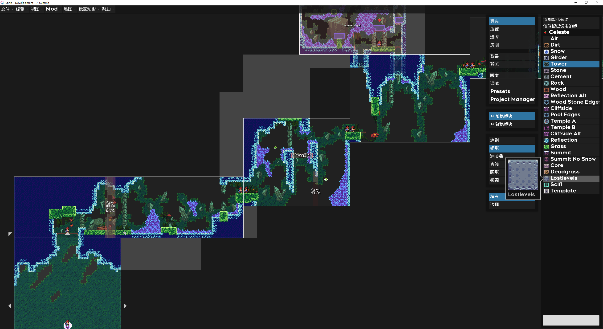
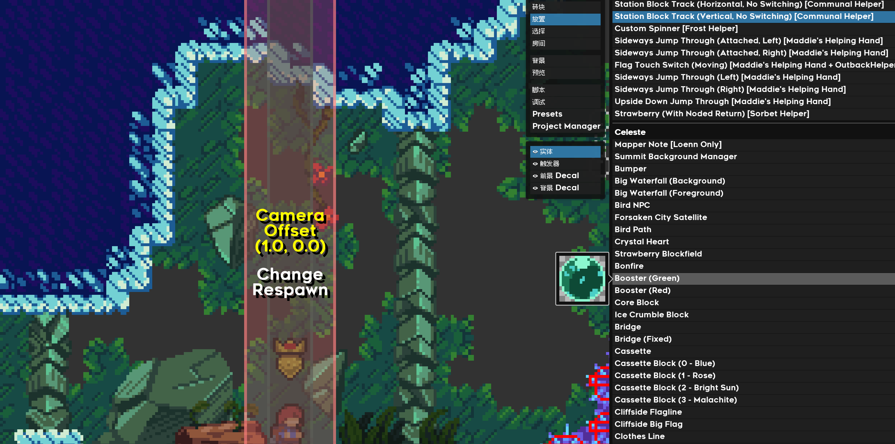
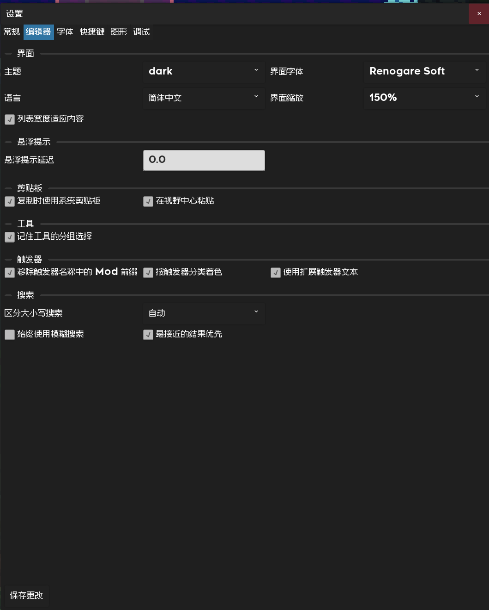
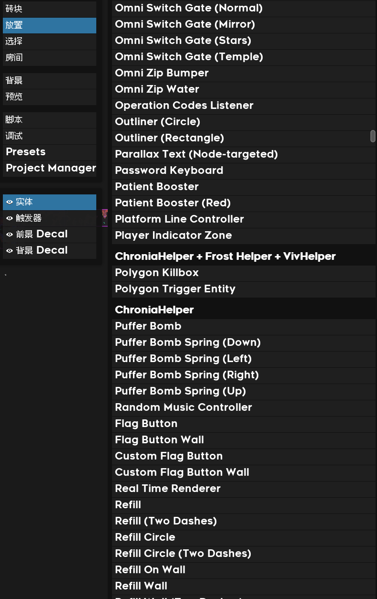
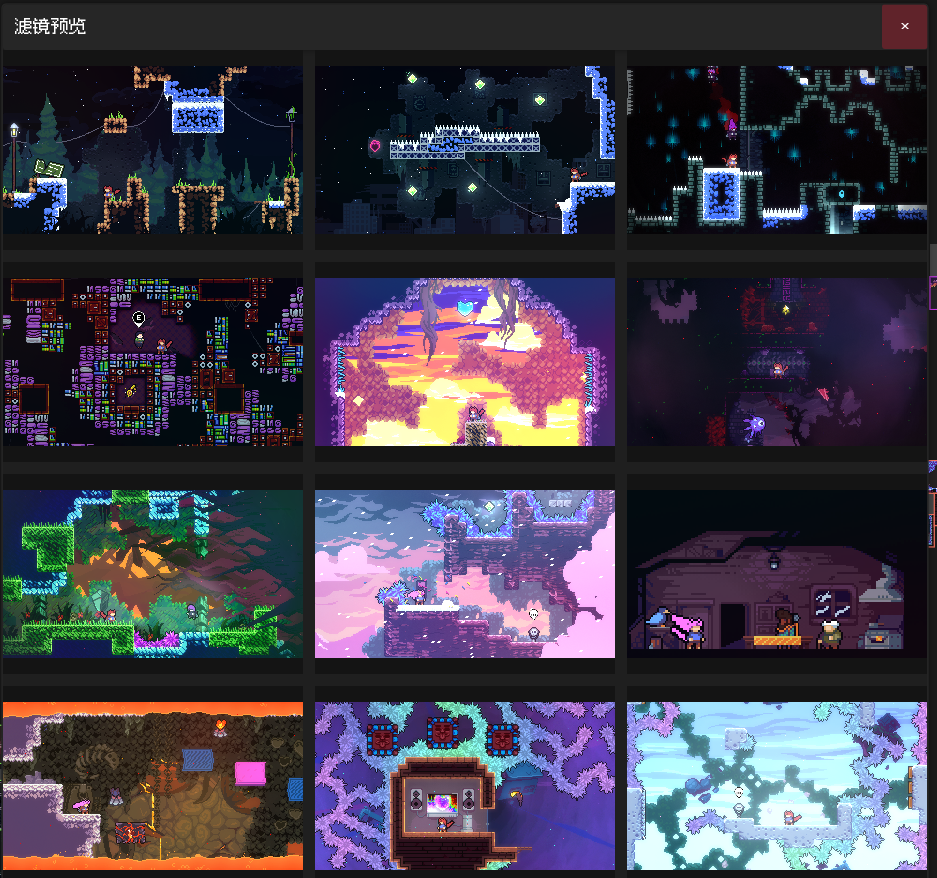
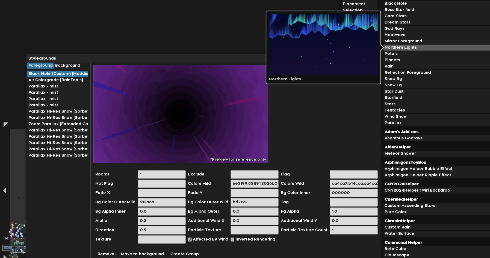
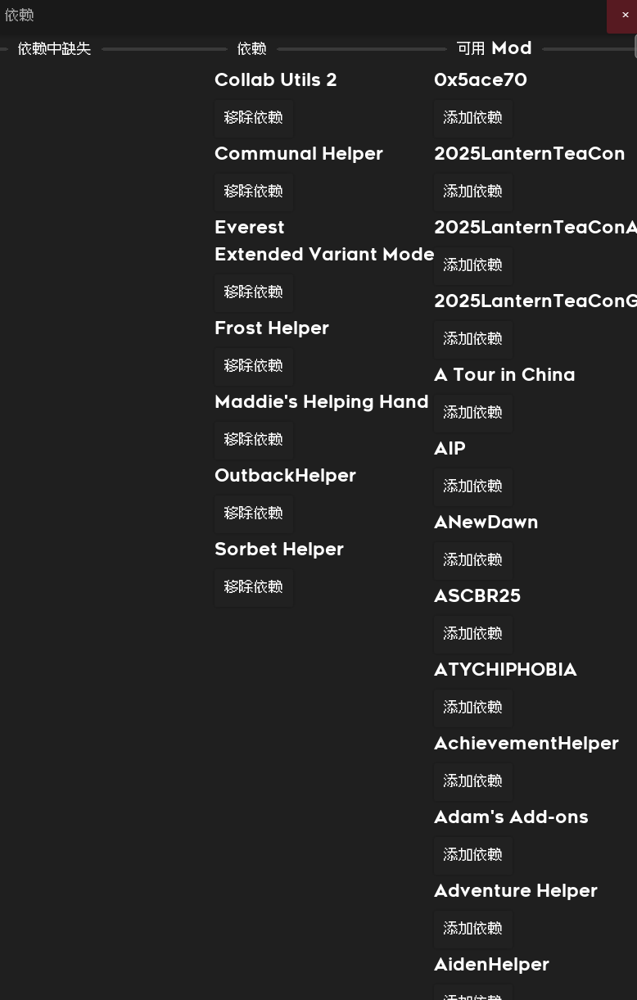

[中文](README.md) | **English**

# Loenn Ultra

Loenn Ultra is a fork of [Lönn](https://github.com/CelestialCartographers/Loenn), the visual level editor for Celeste. It is forked from the `better-loenn` branch of [LuckyBoy-7/Loenn](https://github.com/LuckyBoy-7/Loenn) at version v1.1.10. All upstream functionality is preserved. This fork improves Chinese language support, macOS Apple Silicon support, information shown in the asset lists, performance on large maps, and plugin compatibility.

- Repository: <https://github.com/djgrayon/LoennUltra>
- Downloads: <https://github.com/djgrayon/LoennUltra/releases>

---

## Differences from upstream Lönn

### Platform support

- **macOS (Apple Silicon)**: the macOS build now uses the LÖVE 11.5 universal engine. The launcher script inside `Lönn.app` detects Apple Silicon and starts the process through `arch -arm64`, so the whole process tree is no longer started as x86_64 under Rosetta. The previous behaviour caused persistent stuttering after edits and made saving large maps impossible to complete. The startup log reports `Runtime arch: <arch>` for verification.
- **macOS**: `nfd.so` is replaced with a universal x86_64 + arm64 binary, usable on both Intel Macs and Apple Silicon.
- **macOS**: the `dirent` struct in `lfs_ffi.lua` now matches the arm64 ABI. This fixes directory listings returning empty or garbled file names.
- **Linux**: fixed `utils/filesystem.lua` and `utils/threads.lua` treating non-Windows platforms as Windows. The file dialog libraries (`nfd.so` / `nfd_zenity.so`) now load correctly.

### Added

- New **File > Close**: closes the currently open map without exiting the editor. If there are unsaved changes, a save prompt is shown. Another map can be opened afterwards.
- Info panel, opened with `~`: shows cursor coordinates, the current room name, and the canvas zoom level.
- The Debug tool can search entities and triggers by name and teleport to them.
- 14 new scripts, all supporting multi-selection:
  - **Change Attributes**: changes every entity of one type into another type.
  - **String Replace in Entity/Trigger**: replaces a substring in one attribute of matching entities and triggers.
  - **Convert Fillers to Rooms**: turns vanilla fillers into rooms, taking tiles from the surrounding rooms.
  - **Flip Room**: flips the room content and/or the room position.
  - **Create Template Mod**: creates a new mod folder with a blank map and the default Celeste XML files.
  - **Export to Zip**: updates the mod version and exports the whole mod folder to a zip file.
  - **Transfer Used Decals**: copies decals used by the map from other mods into the current mod.
  - **Get Decal Credits** / **Get Default Tile Credits**: collects the mods whose decals / bundled default tilesets are used by the map, for writing credits.
  - **Auto Add Background Tiles** / **Auto Add Background Tiles Around**: fills background tiles in a room, or around foreground tile edges and spinner entities.
  - **Auto Add Filler**: expands solid tiles around room edges and creates full-tile filler rooms.
  - **Add Spikes Around Object**: adds spikes around an entity or around the outline of a foreground tile area.
  - **Add Spinners In Area**: grows spinners inside a circular area; right-click copies an existing spinner's configuration.
- Hierarchical list styling and preview images in the asset lists: decals, triggers, entities and tiles can be previewed directly in the list.
- Stylegrounds panel supports adding effects by drag and drop, with positional feedback while dragging.
- List entries can copy their asset path to the clipboard or open the containing folder in the file manager.
- Font size is configurable, and the interface font and the map text font can be set separately.
- System IME candidate window and pinyin pre-editing are supported, so Chinese input works in search fields and attribute fields.
- Favourited entries show which mod they come from.

### Changed

- Map loading is multi-threaded; mod zip archives are mounted on demand; Selene to Lua compilation results are cached.
- The default language is Chinese. When a non-Chinese interface is in use, the loading screen shows a one-time hint about switching languages.
- The notification area is moved to the bottom right corner of the workspace instead of spanning the window.
- Lists support drag-and-drop reordering, entries have more spacing, and file paths are displayed in a VS Code style.
- Long trigger text wraps automatically.
- The canvas zoom step is changed to √2.
- New hotkeys: `x` switches between the current and previous tool, `Tab` hides the sidebar, `f` / `b` move the selected decal to the foreground / background.

### Fixed

- **Saving**: a failed disk write left the save lock held, so every subsequent save for that map waited forever. The lock is now released and the failure is reported.
- **Saving**: disk write failures were skipped silently with no message.
- **Undo**: after a bucket fill in `all rooms` mode, a single undo only reverted part of the rooms.
- **Undo**: the canvas kept showing the old content after undoing.
- **Rendering**: selecting a layer in the layer list did not display that layer's content.
- **Rendering**: `drawScreenText` crashed when a drawable had no width or height. This was reproducible on maps using ExCameraDynamics `CameraReferenceFrame` after zooming out.
- **Export**: `Map > Save Map Image` crashed immediately after confirming the save.
- **Export**: `Map > Save Map Image` only exported the current room.
- **Localization**: plugins that only provide `en_gb.lang` displayed `%unknown%` everywhere under a Chinese interface.
- **Plugins**: the `Loenn2/` isolation directory caused older plugins that had not migrated to fail silently, with no menu entry and no log output.
- **Plugins**: `requireFromPlugin` returned `nil` on failure, crashing plugins that depended on the missing library at startup.
- **Plugins**: `drawableFunction` truncated extra arguments appended by plugins, leaving `sprite` as `nil`.
- **Selection**: `isItemSelected` iterated the wrong collection when multiple items were selected.
- **Linux**: the file dialog could not be opened.

### Known issues

- The empty editor screen shown after closing a map does not display the Chinese hint text. That screen is rendered with a pixel font that contains no Chinese glyphs.

---

## Installation

### Windows

Download `LoennUltra-<version>-windows.zip`, extract it into an empty directory and run `Lönn.exe`.

### macOS

Download `LoennUltra-<version>-macos.zip` and extract `Lönn.app`.

If macOS blocks the first launch, run the following in a terminal:

```bash
xattr -dr com.apple.quarantine /path/to/Lönn.app
chmod +x /path/to/Lönn.app/Contents/MacOS/*.sh
```

### Linux

Download `LoennUltra-<version>-linux.zip`, then:

```bash
chmod +x Lönn.sh
./Lönn.sh
```

`nfd.so` and `nfd_zenity.so` are included in the archive.

---

## Migrating from upstream Lönn

- Configuration is separate: this fork uses `loenn2-settings.conf` and does not overwrite upstream's `settings.conf`. The original configuration is migrated once on first launch.
- Language can be changed in Settings → General → Language.
- Plugins are loaded from a mod's `Loenn2/` directory first, falling back to the upstream `Loenn/` directory when `Loenn2/` does not exist. Existing plugins generally work without modification.

## Keyboard shortcuts

Controls are identical to upstream Lönn. The most common shortcuts are listed below; all of them can be changed in Settings → Hotkeys.

| Shortcut | Action |
|---|---|
| `Ctrl + S` / `Ctrl + Shift + S` | Save / Save as |
| `Ctrl + Z` / `Ctrl + Shift + Z` | Undo / Redo |
| `Ctrl + T` / `Ctrl + Shift + T` | Add room / Edit current room |
| `Alt + Arrow keys` | Move room |
| `Ctrl + A` / `Ctrl + Shift + A` | Select all / Deselect all |
| `Ctrl + C` / `Ctrl + X` / `Ctrl + V` | Copy / Cut / Paste |
| `Q` / `E`, `A` / `D` | Shrink / grow width and height (`Ctrl` for 1 pixel steps) |
| `L` / `R`, `V` / `H` | Rotate, flip |
| `~` | Info panel |
| `Tab` | Hide sidebar |
| `x` | Switch between current and previous tool |
| Mouse wheel | Zoom canvas |
| Hold right mouse button and drag | Pan the view |

## Screenshots

Main window: Chinese interface, with the asset lists on the right.



Room editing: selecting a trigger in the room lists available entities and shows preview images.



Settings window (Editor tab): interface language, UI font and UI scale can be changed here.



Asset lists: entities grouped by mod, with a preview image for the selected entry.



Filter preview: browse the available filter textures as a thumbnail grid.



Stylegrounds panel: the selected entry shows a preview and its properties.



Dependencies window: missing dependencies on the left, available mods on the right.



## Feedback

- Report issues and suggestions in this repository's [Issues](https://github.com/djgrayon/LoennUltra/issues). Please include the steps taken, the expected result, the actual result, and `run.log` when possible.
- `run.log` location: Windows `%LOCALAPPDATA%\Loenn\run.log`, macOS `~/Library/Application Support/Loenn/run.log`.

## About this fork

### Where the code comes from

- Upstream project: Lönn ([CelestialCartographers/Loenn](https://github.com/CelestialCartographers/Loenn))
- Direct upstream: the `better-loenn` branch of [LuckyBoy-7/Loenn](https://github.com/LuckyBoy-7/Loenn), forked at version v1.1.10 (commit `b084a59`)
- That `better-loenn` branch is itself based on the `ui-olympUI` branch of Lönn
- This repository: the `better-loenn` branch of `djgrayon/LoennUltra`; all changes after v1.1.10 are maintained here

This fork is maintained by the community and is unofficial. It has no affiliation with the Celeste development team, the original Lönn authors, or the authors of the `better-loenn` branch. Issues in Lönn itself should be reported to the upstream repository; issues in the `better-loenn` branch should be reported to that repository.

Upstream Lönn is the successor to [Ahorn](https://github.com/CelestialCartographers/Ahorn), which is based on [Maple](https://github.com/CelestialCartographers/Maple).

## License

The source code and assets of this project are licensed under Lönn's [MIT license](LICENSE), except as noted below.

The Lönn logo is copyright its original authors and may only be distributed with original copies of the software. If you build on this project, use your own name and branding to avoid confusion with upstream Lönn.

This project includes and uses the following open source projects:

- [dkjson](https://github.com/LuaDist/dkjson)
- [lua-yaml](https://github.com/exosite/lua-yaml)
- [An FFI implementation of luafilesystem](https://github.com/sonoro1234/luafilesystem)
- [A fork of luajit-request](https://github.com/Vexatos/luajit-request)
- [Selene](https://github.com/Vexatos/Selene)
- [xml2lua](https://github.com/manoelcampos/Xml2Lua)

It depends on:

- [LÖVE](https://love2d.org/)
- [A fork of the lua bindings for nativefiledialog](https://github.com/Vexatos/nativefiledialog/tree/master/lua)
- [libcurl](https://curl.se/libcurl/)
